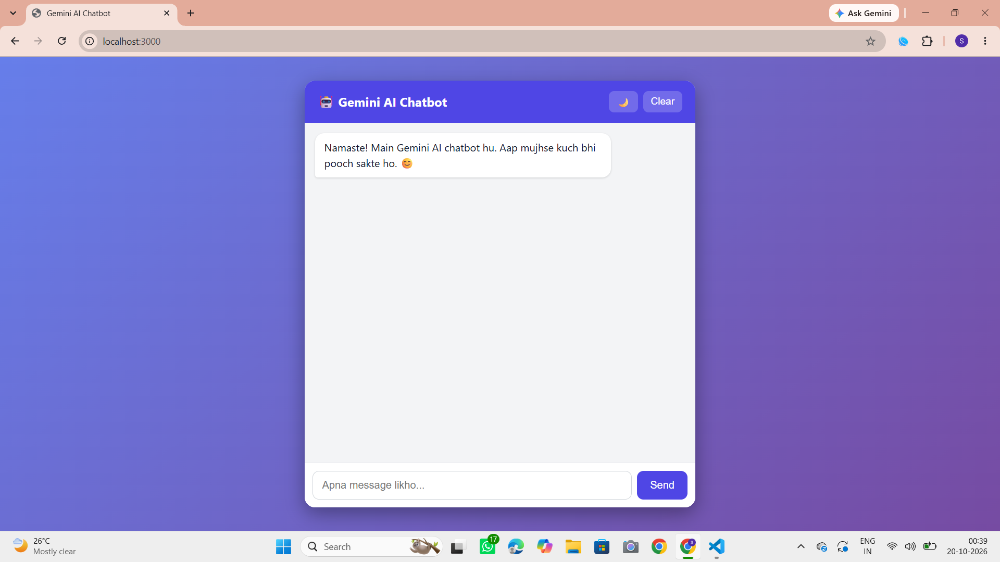
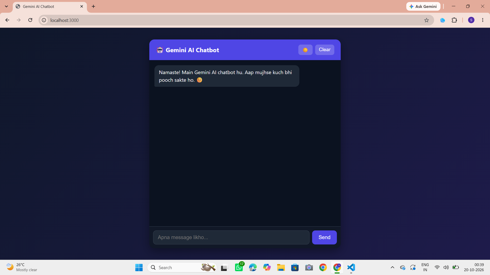

# Gemini AI Chatbot

A simple AI chatbot built with HTML, CSS, JavaScript, Node.js and the Google Gemini API.
You type a message, the server sends it to Gemini, and the reply shows in the chat.

## Screenshots

| Light Mode | Dark Mode |
|---|---|
|  |  |

## Features

- Chat with Gemini AI (Hindi, Hinglish and English supported)
- Bot remembers the earlier messages in the chat
- Chat history is saved in the browser, so it stays after a page refresh
- Dark mode and light mode (your choice is saved)
- Typing animation while the bot is replying
- Code blocks and bold text are shown properly in replies
- Clear button to delete the chat
- Auto-retry when the Gemini server is busy (503 error)
- API key is kept safe on the server, not in the browser

## Tech Stack

- **Frontend:** HTML, CSS, JavaScript
- **Backend:** Node.js, Express
- **AI:** Google Gemini API
- **Other:** dotenv (for secret keys), localStorage (for saving chat)

## Project Structure

```
AI-Chatbot/
├── public/
│   ├── index.html
│   ├── style.css
│   └── script.js
├── server.js
├── package.json
├── .env.example
└── .gitignore
```

## How to Run Locally

1. Install [Node.js](https://nodejs.org) (version 18 or newer).
2. Clone this project:
```
   git clone https://github.com/Sakshi1265/AI-Chatbot.git
   cd AI-Chatbot
```
3. Install the packages:
```
   npm install
```
4. Create a file named `.env` (copy `.env.example`) and add your Gemini API key:
```
   GEMINI_API_KEY=your_api_key_here
   GEMINI_MODEL=gemini-3.8-flash
```
   You can get a free key from [Google AI Studio](https://aistudio.google.com/apikey).
5. Start the server:
```
   node server.js
```
6. Open your browser and go to `http://localhost:3000`.

## How It Works

1. You type a message in the browser.
2. The browser sends the chat history to the server (`POST /api/chat`).
3. The server adds the secret API key and calls the Gemini API.
4. Gemini sends a reply, and the server sends it back to the browser.
5. The browser shows the reply and saves the chat in localStorage.

## Why a Backend?

If the API key is written in the frontend code, anyone can see it in the browser.
So the key is stored in the `.env` file on the server, and the browser never sees it.

## What I Learned

- How to call an API using `fetch` and `async/await`
- How to build a simple Express server and a POST route
- How to keep secret keys safe using `.env` and `.gitignore`
- How to save data in the browser using `localStorage`
- How to build dark mode using CSS variables
- How to handle API errors (wrong model name, quota limit, server busy)

## Notes

- The free Gemini plan has daily request limits. If you see a "quota exceeded" error, wait for some time or use another API key.
- Chat is saved only in your own browser. It will not show on another device.

## Future Improvements

- Streaming replies (word by word)
- Login system and database to save chat on every device
- Voice input
- Deploy online (Render or Railway)

## Author

Sakshi